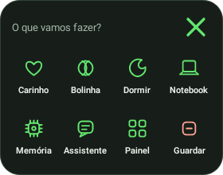
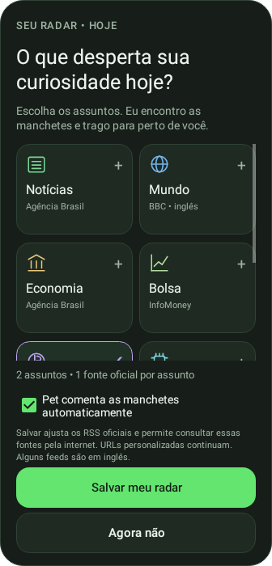
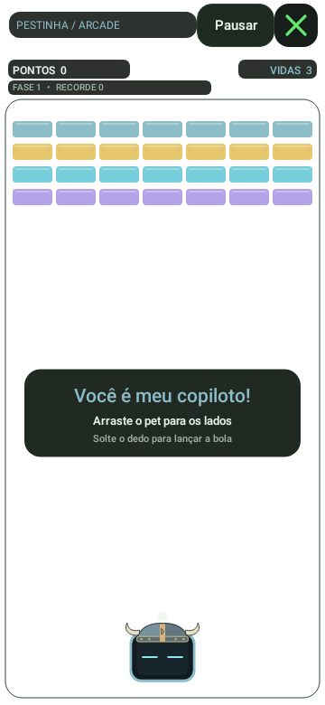

# Pestinha Android

Um pet sobre os seus aplicativos, com personalidade, memória, tarefas, notícias e um Arkanoid em que o próprio boneco vira a plataforma.

## Baixar e instalar

**Versão atual: 0.13 experimental.** Android 8.0+, ARM64 ou x86_64.

### [⬇ Baixar Pestinha-Android.apk](https://github.com/duOCELOT/pestinha-duOCELOT/releases/latest/download/Pestinha-Android.apk)

APK direto, sem ZIP ou login. Não precisa de Termux, Ubuntu ou VNC.

1. Baixe e abra o APK no celular. Se solicitado, autorize a instalação para o navegador/gerenciador usado.
2. Abra **Pestinha** e permita **Aparecer sobre outros apps**.
3. Escolha o personagem e toque em **Soltar o pet**.

**Para atualizar:** instale sobre a versão atual. Não desinstale antes de exportar sua memória: desinstalar ou limpar dados apaga os registros locais.

## Versões e novidades

**[Todas as informações das versões estão nesta página →](CHANGELOG.md)**

Ela reúne o que mudou, qual é a versão atual e quais versões têm APK publicado.
A **0.13** traz o **fundo transparente do Arkanoid**. As funções anteriores continuam incluídas.

[Release atual: APK, hash e código correspondente](https://github.com/duOCELOT/pestinha-duOCELOT/releases/latest)

## Conheça o app

  
  
  

Prévias da interface renderizadas em testes, com dados de exemplo. O campo do jogo é transparente; no celular, você vê o aplicativo aberto por baixo.

- **Bryan, Jorge e Mimir:** aparência, temperamento e memórias separados.
- **Interação:** carinho, brinquedos, sensores e opção de fixar o pet onde soltar.
- **Arkanoid:** pet como plataforma, três vidas, fases e recorde por personagem.
- **Organização:** tarefas com prazo, água, foco e lembretes.
- **Meu radar:** interesses do dia, RSS e manchetes comentadas em texto.
- **Memória e pausas conscientes:** gráficos do pet e acompanhamento opcional do tempo nos apps escolhidos.

## Precisa de ajuda?

| Você procura | Abra |
| --- | --- |
| Instalação, atualização, gestos, permissões e backup | [Guia de uso](docs/android/GUIA-DO-APK.md) |
| Novidades e disponibilidade de cada versão | [Central de versões](CHANGELOG.md) |
| Explicação de cada função | [Guias do Android](docs/android/README.md) |
| Código, compilação e publicação | [Área de desenvolvimento](https://github.com/duOCELOT/pestinha-duOCELOT/blob/android/android/README.md) |

Memória e registros ficam no aparelho. RSS usa internet quando escolhido/ativado;
o Acesso ao uso é opcional. O app não lê conteúdo da tela ou compromissos e não tem LLM, conversa livre ou voz.
Este é um APK **experimental de desenvolvimento**, com assinatura pública fixa desde 0.2.
[Limites, privacidade e compatibilidade](docs/android/GUIA-DO-APK.md).

Adaptação por duOCELOT de [mille-okws/pestinha](https://github.com/mille-okws/pestinha), sob [GPL-3.0-or-later](LICENSE).
[Documentação original de desktop](README-DESKTOP.md) · [Origem das imagens](docs/android/images/README.md).
