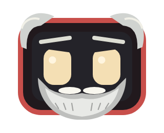

# Cuidados, visual e funções locais — 0.14

## Notícias: fechar e ler são ações diferentes

O corpo do balão e o botão **Fechar** apenas dispensam a notícia.
Somente **Ler notícia** abre o cartão no app; o site ainda exige tocar no botão da matéria.
Convites de tarefas continuam podendo abrir o formulário, porque esse é o propósito do convite.

## Cuidados e guarda-roupa

Na tela principal ou no menu de segurar, abra **Cuidados**. Com o pet solto:

- **Servir lanche** reduz a fome; **Cuidar / descansar** melhora a saúde simulada.
- **Cobertor** alivia frio e **Sombra** alivia calor.
- **Clima simulado** escolhe ameno, frio ou calor. Não mede a temperatura do aparelho nem dados corporais.
- As necessidades evoluem apenas em ticks ativos: não há morte, castigo por ausência ou decaimento offline.
- Fome/desconforto prolongados podem aumentar o mal-estar fictício. Esses números não são orientação médica.

O estado fica em `android.json` por personagem e acompanha o backup neural existente.
Arquivos antigos sem o campo `care` recebem valores iniciais compatíveis, sem apagar o aprendizado.

O guarda-roupa permite paletas prontas ou cor hexadecimal `#RRGGBB` para olhos/moldura e um acessório:
original, nenhum, laço, óculos, gravata, elmo ou barba. **Restaurar visual original** limpa só
as preferências visuais deste personagem. Essas preferências são privadas (`appearance_<id>`)
e ainda não entram no backup neural JSON. Não mudam a identidade/seed do personagem.

## Personagens novos

- **Luna:** pet feminina, curiosa e afetuosa, moldura rosa e laço como visual inicial.
- **L.U.L.A:** robô com barba clara e moldura vermelha; caricatura fictícia
  inspirada em Luiz Inácio Lula da Silva. Não oficial, sem endosso ou falas reais.
  As frases são brincadeiras do pet, não aconselhamento político ou campanha.

Ambos mantêm o formato do projeto e têm memórias próprias. Guarde o pet antes de trocar.

## Preparação para modelos leves

`LocalFunctions.Provider` é um contrato de função tipada, inicialmente com o provedor
**regras-locais**. Ele recebe apenas fome, mal-estar e temperatura simulados e retorna
uma sugestão dentre ações permitidas. É opcional e desligado por padrão.
A sugestão não executa o cuidado: você escolhe o botão correspondente.

Não há modelo/LLM instalado, download automático ou envio desses dados à internet.
A interface prepara o encaixe de provedores locais futuros, que ainda precisarão de
seleção explícita, runtime compatível, limites de memória/tempo e execução fora da UI.
Nenhuma saída do provedor pode virar código, comando ou ação arbitrária.

Na 0.15, o nome exibido passa a L.U.L.A. O visual ganha cabelo grisalho, sobrancelhas e barba com bigode em camadas. O ID `lula` e a seed são preservados para manter memórias e backups compatíveis.

Prévia nativa renderizada nos testes da compilação 0.15, não captura de um aparelho.
