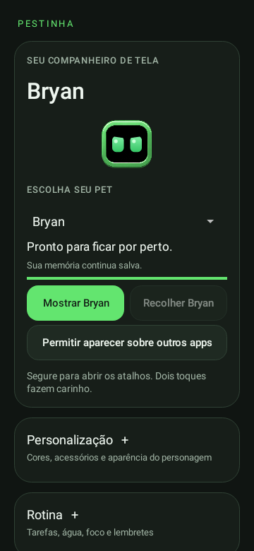
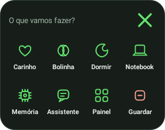

# Guia do APK: telas, funções e uso

**Guia da versão atual: Pestinha Android 0.22 experimental.**
[Versões anteriores e seus arquivos](versions/README.md)
[Apresentação](README.md) · [Referência técnica](REFERENCIA-TECNICA.md)

## 1. Primeiro uso

1. [Baixe `Pestinha-Android.apk` diretamente da Release](https://github.com/duOCELOT/pestinha-duOCELOT/releases/download/android-v0.22.0/Pestinha-Android-0.22.0.apk) e abra para instalar. Não precisa de login nem ZIP.
2. Abra **Pestinha**.
3. Se aparecer **Permitir aparecer sobre outros apps**, toque e autorize no Android.
4. Volte ao app e toque em **Mostrar pet**.
5. Permita notificações para acessar os controles e receber avisos.

O personagem deve aparecer em uma pequena janela transparente. O restante da
tela continua disponível para os outros aplicativos. Algumas telas protegidas
do Android ou de outros apps podem ocultar overlays.

Atualizações com a mesma assinatura preservam os dados. Versões antigas 0.1
usavam assinaturas diferentes: não desinstale para resolver um conflito sem
antes cuidar do backup. Veja o [procedimento de migração](https://github.com/duOCELOT/pestinha-duOCELOT/blob/android/android/README.md#memória).

## 2. Tela principal

O cartão superior reúne **Mostrar pet** e **Recolher pet** lado a lado, junto da escolha do personagem. Os controles habilitam conforme o estado do serviço.

O cartão superior apresenta o personagem, sua prévia visual, o estado atual,
a energia e o botão para soltá-lo. A autorização de overlay só aparece quando
necessária. Quando o pet já está ativo, o botão indica que ele está solto.

| Categoria | Conteúdo |
| --- | --- |
| Cartão superior | Personagem, estado, Mostrar pet e Recolher pet |
| Personalização | Cores e acessórios; ajustes de tamanho, velocidade e comportamento |
| Rotina | Tarefas, água, foco, lembretes, cuidados e pausas conscientes |
| Notícias | Radar e gerenciamento de fontes RSS |
| Memória | Gráficos, aprendizado e backups |
| Jogos e interações | Quebra-blocos, carinho, brinquedos, memes e atividades |
| Configurações | Movimento, sensores, calibração, privacidade e licença |

Toque em **+** para abrir ou em **−** para recolher. A escolha fica salva por tela e categoria. Os cabeçalhos também informam o estado para leitores de tela. Os controles de cada seção aparecem em uma coluna vertical, com textos que podem ocupar mais de uma linha.

O atalho **Cores e acessórios** abre a seção de personalização diretamente. **Gerenciar fontes RSS** abre a seção correspondente do Assistente. No Radar, os assuntos do dia e atualizar notícias ficam acessíveis; frequência e comentários ficam em Configurações do radar.

**A energia mostrada é uma necessidade do personagem, não a bateria do celular.**
Recolher pet não cancela timers, lembretes nem alarmes enviados ao relógio.

## 3. Pet flutuante e gestos

| Gesto | Resultado |
| --- | --- |
| Um toque | Cutucada; alimenta uma reação da rede |
| Dois toques | Carinho; pode favorecer associações do contexto atual |
| Arrastar | Leva o pet para outra posição |
| Arrastar e soltar rápido | Arremessa o pet, com movimento e colisões |
| Segurar sem arrastar | Abre o menu de pequenos ícones |

O pet para ao encostar e durante o menu para facilitar a interação. As emoções
não são apenas uma cor decorativa: a rede influencia o rosto e aspectos do
movimento. Mesmo assim, nem todo toque produz uma emoção diferente na hora;
existem suavização, habituação e necessidades internas.

### Menu rápido

| Ícone / rótulo | Descrição |
| --- | --- |
| Fixar no lugar / Soltar posição | Mantém o pet onde for solto ou restaura seu movimento |
| Quebra-blocos | Abre o jogo sobre os apps, usando o próprio pet como plataforma |
| Carinho | Faz carinho sem sair do aplicativo em uso |
| Bolinha / Sem bola | Mostra ou guarda a bolinha |
| Dormir / Acordar | Alterna o sono do personagem |
| Notebook / Parar | Coloca ou retira o notebook |
| Memória | Abre o painel de memória e aprendizado |
| Assistente | Abre as utilidades do app |
| Painel | Abre a tela principal completa |
| Guardar | Encerra o pet flutuante e salva sua memória |

Toque no **X** ou fora do menu para fechar. Ele se reposiciona para caber na
tela e fecha ao girar o aparelho ou apagar a tela. Os toques fora da pequena
janela não ficam presos em uma camada que cobre o celular inteiro.

## 4. Brincar e interagir

### Bolinha

Mostre a bolinha pelo menu ou pelo painel. Ela tem gravidade e quique, pode ser
arrastada e recebe chutes ao se aproximar do pet. Pegar ou afastar a bolinha
alimenta uma reação da rede. Ela também participa da física por inclinação.

### Notebook

A ação de trabalhar mostra um notebook na frente do corpo e mantém o pet
parado. É uma adaptação do comportamento de desktop. Não significa que o app
está lendo seu editor, teclado ou outros aplicativos.

### Bilhetes e memes

**Deixar um bilhete** pede uma frase do personagem. **Escolher imagem para
memes** abre o seletor de arquivos do Android para você indicar uma imagem;
o app guarda uma cópia reduzida, por personagem, em formato PNG. **Mostrar meu
meme** usa essa imagem. Não há acesso livre à sua galeria.

O bilhete ou imagem pode ser dispensado por toque. A memória episódica
registra o resultado: fechar rapidamente tende a contar negativamente; deixar
na tela por cerca de 18 segundos pode contar como aceitação. Dar atenção após
uma ação também pode influenciar o aprendizado. Não é uma conversa com IA.

**Travessuras automáticas** é opcional e permite ao pet escolher entre ações
permitidas, incluindo bilhetes, memes quando há imagem, atravessar e não fazer
nada. O aprendizado influencia essas escolhas; não é uma sequência idêntica
para todos os personagens.

### Protestos, tristeza e cantinho

A raiva ou tristeza sustentada pode desenvolver estágios e cartazes, quando
as travessuras estão habilitadas. Carinho alivia a insatisfação.

O cantinho Android é uma adaptação: você pode colocá-lo ou retirá-lo pelo
painel. Ele permanece parado, pode sair por tempo/atividade da rede, e carinho
o retira do cantinho. Não é o controlador completo de castigo do desktop.

### Contexto e modo de teste

**Escolher atividade** permite indicar Livre, Trabalho, Jogo, Música ou Social.
Esses contextos chegam à rede como sinais. O app não descobre automaticamente
qual atividade você está fazendo em outro aplicativo.

O modo de teste usa tempos mais curtos para experimentar necessidades,
emoções e travessuras. Vale para a sessão atual; não acelera os timers do
Assistente. Para observar travessuras rapidamente, ative o modo antes de ligar
as travessuras automáticas. Desative-o para o uso normal.

## 5. Personagem e aparência

| Personagem | Como identificar | Personalidade |
| --- | --- | --- |
| Bryan | Verde, moldura e olhos do padrão original | Curioso, brincalhão e com as reações originais |
| Jorge | Dourado, olhos amarelos e gravata | Coach fictício de sátira, com temperamento próprio |
| Mimir | Azul-gelo e elmo viking com detalhes em latão | Sábio, resmungão, humor seco e referências nórdicas |
| Luna | Cabelo e laço; paleta personalizável | Curiosa e afetuosa |
| Presidente | Cabelo e barba brancos, moldura vermelha e faixa decorativa | Bem-humorado, fala popular e histórias |

Para trocar: **Recolher pet → aguardar o salvamento → seletor no cartão superior
→ escolher o nome → Mostrar pet**. A prévia muda assim que a seleção é aceita.

A 0.17 usa arte detalhada com olhos animados e cores independentes para moldura e olhos. Trocar um acessório usa a base detalhada com item desenhado pelo app; veja [os limites da arte](ARTE-HD.md).

Cada personagem mantém seu aprendizado e sua imagem personalizada. Tamanho,
velocidade e várias preferências de interface são configurações gerais do app.
Os bilhetes de Mimir são textos próprios; o tom inteligente não corresponde a
um LLM instalado ou a fala livre.

## 6. Movimento e inclinação

1. Abra **Movimento e inclinação**.
2. Ative **Mover ao inclinar o celular**.
3. Incline devagar para mover o pet e a bolinha.
4. Ajuste **Sensibilidade** se necessário.
5. Use **Calibrar nesta posição** para tornar o ângulo atual neutro.

**Restaurar gravidade natural** remove a calibração. A calibração é temporária
e é zerada ao girar a orientação da tela.

O sensor de gravidade, ou o acelerômetro filtrado, controla a posição. O
giroscópio, se disponível, acrescenta balanço ao corpo. Há atrito, limite de
velocidade e quique. Arrastar tem prioridade; notebook, cantinho e menu aberto
mantêm o pet parado. Em modo inclinação, ele pode deslizar mesmo dormindo.

Os sensores desligam quando o modo é desativado, a tela apaga ou o serviço é
encerrado. Não há gravação de amostras brutas ou necessidade de sacudir forte
o aparelho. Sem sensor compatível, o arraste continua disponível.

## 7. Tela Assistente

### Foco e pausas

Escolha **Focar por 25 minutos**, **Pausa de 5 minutos** ou uma duração de foco
entre 1 e 180 minutos. Há um único timer de foco/pausa ativo: iniciar outro
substitui o anterior. A alternância entre foco e pausa é manual.

Se o pet estiver solto, ele mostra o notebook durante o foco. O timer é salvo
e pode gerar uma notificação sem o pet visível. **Cancelar timer** encerra o
timer do Pestinha, não um alarme criado em outro app.

Sem autorização para horário preciso, o Android pode atrasar o aviso durante
o repouso. A tela oferece **Permitir notificações** e **Autorizar horário
preciso (opcional)**. Não Perturbe e as configurações do canal também afetam
como o aviso é apresentado.

### Lembretes locais

Toque em **Novo lembrete com data e hora**, escreva o texto e escolha um
horário futuro. O lembrete aparece na lista e pode ser cancelado individualmente.
São avisos únicos: ainda não há repetição diária/semanal.

Os avisos persistem no aparelho e são reagendados no boot, em mudanças de
horário e ao abrir o painel Assistente. Forçar parada pode impedir a entrega;
abra esse painel para rearmar os pendentes. Não dependem de um servidor.

### Agenda e relógio

| Ação | O que acontece |
| --- | --- |
| Criar evento na agenda | Pede título e horário, prepara um evento de uma hora e abre o calendário para revisão |
| Criar alarme no relógio | Pede o horário e encaminha o pedido ao app de relógio |
| Abrir timer do relógio | Encaminha um timer de 25 minutos para o relógio |

A interface e a confirmação no destino dependem do aplicativo instalado. Revise
os dados na agenda ou no relógio. O Pestinha não lê seus compromissos, não
lista alarmes existentes e não altera/exclui eventos já salvos.

### Notícias RSS/Atom

1. Cole a URL **HTTPS de um feed RSS ou Atom**, não apenas a página inicial do site.
2. Toque em **Adicionar feed**.
3. Toque em **Atualizar notícias agora**.
4. Leia título, trecho, fonte, data informada pelo feed e horário da consulta.
5. Use **Abrir matéria no navegador** ou **Trazer manchete com o pet**.

A lista de assinaturas começa vazia. **Escolher fontes oficiais por categoria**
oferece uma biblioteca de 14 endereços; você escolhe até dez feeds ativos.
Veja a [lista de fontes e referências dos editores](FONTES-RSS.md). Cada consulta aceita até 30 itens
por fonte, com limites de tamanho e tempo de conexão/leitura. O radar opcional permite consultas automáticas com o pet solto e a tela desbloqueada. Não há resumo por LLM ou busca geral na web.

Os trechos vêm do feed e podem estar incompletos. O cache permite ler a última
consulta offline e não representa informação em tempo real. Erros de fontes
são exibidos; uma atualização parcial pode mostrar apenas as fontes que
responderam. Se todas falharem, a cópia anterior pode continuar visível.

Remover um feed limpa a cópia de notícias salva. **Apagar notícias salvas** limpa
o cache sem remover a lista de feeds. Notícias são dados exibidos como texto:
não têm poder de executar ações do app.

### Pausas conscientes e recados

O cartão **Pausas conscientes** na tela principal e o botão correspondente no
Assistente abrem a medição opcional de uso. Autorize Acesso ao uso no Android,
escolha os apps e ative os recados. O pet pode dizer quanto tempo foi usado em
uma sessão ou no total do dia, com limite e intervalo configuráveis.

A função vem desligada, não lê conteúdo e funciona automaticamente com pet
solto e tela desbloqueada. As estimativas e os recados ficam locais; ainda não
é conversa livre por LLM. [Instruções completas e limitações](PAUSAS-CONSCIENTES.md).

## 8. Tela Memória e cérebro

Quando o pet está ativo, o painel mostra o estado ao vivo; guardado, apresenta
o último estado salvo. No primeiro uso, pode ser necessário soltá-lo por alguns
segundos antes de existir uma fotografia completa do estado.

| Informação | Como interpretar |
| --- | --- |
| Energia | Reserva do pet; recupera com descanso |
| Estimulação | Quanto estímulo recebeu; baixa estimulação pode contribuir para tédio |
| Carência | Necessidade de contato; mais alta significa mais falta de atenção |
| Humor | Valência emocional, não uma avaliação da pessoa que usa o app |
| Motores em Hz | Atividade dos grupos neurais que influenciam comportamentos |
| Associações aprendidas | Canal, alvo e peso ajustado pelo aprendizado |
| Habituação | Sensibilidade ao sinal: 1 corresponde à sensibilidade cheia |
| Condicionamento | Associações antecipadas, como a reação ao pressionar o pet |
| Preferências | Resultados de ações em contextos anteriores |
| Últimos episódios | Registros recentes de travessuras e seus resultados |

Um peso positivo não significa “bom” isoladamente: depende do canal e do alvo.
Esses números não são pensamentos, mensagens ou lembranças em linguagem natural.
O histórico é limitado, não um registro eterno de tudo o que acontece no celular.

### Salvar, exportar e restaurar

O app tenta salvar a cada 15 segundos, ao apagar a tela e ao guardar. Isso não
é gravação instantânea de cada gesto. O botão **Consolidar lembranças agora**
reorganiza preferências a partir dos episódios, com o pet ativo.

**Exportar memória / backup JSON** abre o seletor de destino. Se o pet está
ativo, a exportação solicita um salvamento antes de copiar os arquivos.

Para restaurar:

1. Guarde o pet e aguarde o salvamento.
2. Selecione o personagem correspondente ao backup.
3. Abra **Memória e cérebro → Restaurar backup**.
4. Escolha o arquivo JSON e confirme a substituição.
5. Solte o personagem novamente.

O backup inclui os arquivos de aprendizado, necessidades e histórico do
personagem. **Não inclui imagem de meme, configurações gerais, feeds, cache,
timers, lembretes ou dados de acompanhamento de apps.** Atualizar normalmente o APK conserva esses dados, mas
desinstalar/limpar dados apaga a área privada do app.

**Apagar memória deste personagem** pede confirmação e apaga seus arquivos de
estado. Não é necessário para trocar de personagem. Exporte antes se quiser
manter uma cópia do aprendizado.

## 9. Permissões e telas externas

| Autorização / integração | Finalidade | Observação |
| --- | --- | --- |
| Aparecer sobre outros apps | Desenhar o pet e seus objetos | Necessária para o pet flutuante |
| Notificações | Avisos e acesso aos controles | Necessária para criar os avisos locais pelo app |
| Horário preciso | Agendar avisos com maior precisão | Opcional; há alternativa aproximada |
| Internet | Consultar os feeds que você atualizar | Sem envio da memória do pet aos feeds |
| Acesso ao uso | Estimar tempo nos apps escolhidos | Opcional, exige autorização e ativação; não lê conteúdo |
| Sensores de movimento | Inclinação e balanço | Opcionais; param com tela apagada |
| Seletor de imagem | Ler a imagem escolhida por você | Não abre acesso geral à galeria |
| Agenda/relógio | Encaminhar pedidos ao app de destino | Não dá leitura completa da agenda ao Pestinha |

A permissão para sobreposição não é permissão para ler a tela. O app não usa
serviço de acessibilidade, captura de tela, câmera ou microfone.

## 10. Problemas comuns

| Situação | O que verificar |
| --- | --- |
| Pet não aparece | Autorização de overlay, botão Soltar e eventual mensagem de erro no painel |
| Pet some em um app específico | Algumas telas protegidas bloqueiam overlays |
| Não consigo trocar personagem | Guarde o pet e aguarde o salvamento terminar |
| Pet parado | Menu aberto, dedo pressionado, sono, notebook ou cantinho; confira a inclinação se habilitada |
| Inclinação estranha | Calibre na posição desejada, reduza sensibilidade ou restaure a gravidade natural |
| Lembrete atrasado | Notificações, horário preciso, economia de bateria e Não Perturbe |
| Avisos pararam após forçar parada | Abra o painel Assistente para rearmar os pendentes |
| Notícias vazias | Use o endereço do feed RSS/Atom HTTPS, confira os erros e tente atualizar |
| Dados de memória parecem antigos | Pet guardado mostra a última fotografia salva; solte-o para acompanhar ao vivo |
| Atualização recusada por assinatura | Não apague dados sem backup; consulte a migração das versões 0.1 |
| Sistema encerrou o pet | Abra o app e solte novamente; confira as restrições de bateria do Android |

## 11. O que ainda não existe

Não há chat por LLM, voz, leitura das notificações de outros apps, leitura de
agenda, busca geral na web, análise da tela ou reprodução completa das funções
de desktop. A personalidade combina regras, rede neural e conteúdo escrito;
não implica acesso livre ao celular.

## Água, contadores e painel por personagem

Em **Assistente → Água ao longo do dia**, ative notificações e os lembretes.
Escolha intervalo (30, 60, 90 ou 120 minutos) e início/fim no mesmo dia.
O padrão é 08h–22h a cada 60 minutos. Não há avisos fora dessa janela;
um aviso atrasado agenda o próximo a partir da entrega, sem disparar todos os atrasados.
Economia de bateria pode atrasar notificações. O agendamento é local e é rearmado
no reinício. Forçar a parada do app no Android exige reabri-lo para retomar.
O botão **Bebi água** registra manualmente um copo, com contador que muda a cada dia.
Não é uma medição automática nem recomendação de volume diário. Pausar cancela o próximo aviso.

Em **Pausas conscientes**, as medições dos apps escolhidos agora têm barras
comparativas e duração em horas, minutos e segundos. Dependem de Acesso ao uso
e continuam sendo estimativas do Android. Atualize para obter uma nova leitura.

Em **Memória e cérebro**, escolha Bryan, Jorge ou Mimir para consultar sua personalidade,
sem alterar o pet solto. O monitor usa a paleta escura e as barras do monitor original:
necessidades, temperamento de origem, atividade dos motores em Hz, habituação e interações.
O temperamento de origem vem do JSON do personagem; não é uma inferência de personalidade por IA.
O estado do pet solto é atualizado ao vivo; os demais mostram o último estado salvo.
Sem estado salvo, o painel informa a ausência de medições em vez de inventar números.
Os dados técnicos, associações aprendidas e episódios continuam acessíveis em um painel expansível.
Exportar, restaurar e apagar se referem ao personagem consultado, com as proteções anteriores.

Os novos **contadores do pet** acumulam tempo ativo na tela: acordado, dormindo,
caderninho, cantinho e contextos. Começam nesta versão e acompanham o backup de cada personagem.
Não contam tempo com o pet guardado ou a tela apagada. Contextos e atividades se sobrepõem;
as barras não devem ser somadas como se fossem categorias exclusivas.
Os registros de água e configurações do assistente não fazem parte do backup neural.

## Tarefas e prazos

O pet pergunta o que você tem para fazer. Toque no convite, escreva a tarefa,
defina a entrega e escolha a frequência de acompanhamento. O painel permite
começar, concluir, adiar o aviso e mudar o prazo. Veja o [guia das tarefas](TAREFAS.md).

## Meu radar

Seleção diária de interesses em cartões, RSS configurados por assunto e manchetes
comentadas pelo pet, com fonte e link para a matéria. Veja o [guia do radar](MEU-RADAR.md).

## Fixar o pet no lugar (0.11)

Segure o boneco e toque em **Fixar no lugar** no menu rápido.
Agora você pode arrastá-lo e soltá-lo: ele permanece nessa posição, sem cair,
passear, girar com a inclinação ou continuar o impulso de um arremesso.
Segure novamente e escolha **Soltar posição** para restaurar o movimento normal.
A opção e a posição são mantidas ao guardar/abrir o pet e valem para o personagem solto.

O rosto, as reações, os lembretes, as notícias e a interação continuam ativos.
A bolinha mantém sua própria física, inclusive inclinação quando habilitada.
A preferência de inclinação é preservada para quando você soltar a posição.
Se a orientação, o tamanho ou a área da tela mudar, a posição pode ser ajustada
para que o boneco continue dentro dos limites visíveis.

## Quebra-blocos sobre os apps

Segure o pet e escolha **Quebra-blocos**. O próprio boneco vira a plataforma: arraste
para os lados, quebre os blocos, avance fases e guarde um recorde por personagem.
Pausar/fechar ficam no topo. Veja o [guia do jogo](QUEBRA-BLOCOS.md).

[Histórico e versão disponível para download](../../CHANGELOG.md).

## Cuidados, visual e novos personagens

[Guia dos cuidados e guarda-roupa](CUIDADOS.md): fome, saúde, clima simulado, cores, acessórios e funções locais.
O catálogo inclui Bryan, Jorge, Mimir, Luna e Presidente. Na 0.16, a escolha fica no cartão superior, junto da prévia. Recolha o pet antes de trocar.
Nos balões de notícias, tocar no texto ou em Fechar apenas dispensa. Use Ler notícia para abrir o cartão.

## Correção do Bryan na 0.21

O Bryan pode usar sua definição original sem campo de aparência: o app aplica a paleta padrão e depois as cores e acessórios escolhidos por você. Não é preciso apagar memória nem restaurar preferências. Os controles exibem o personagem selecionado, como Mostrar Bryan e Recolher Bryan; nome e descrição são atualizados independentemente da arte. Após atualizar, toque em Mostrar Bryan para iniciar uma nova sessão.

## Interface de cores e protestos na 0.22

Personalização abre um seletor de cores com prévia, HEX, RGB, HSL e CMY. A seleção de apps em Pausas conscientes mostra ícones e nomes com busca. O app tem um novo ícone adaptativo. Jogos e interações inclui uma prévia de cartazes, faixas e bandeiras animados; os protestos espontâneos usam as mesmas peças. [Guia completo dessas funções](CORES-E-PROTESTOS.md).
