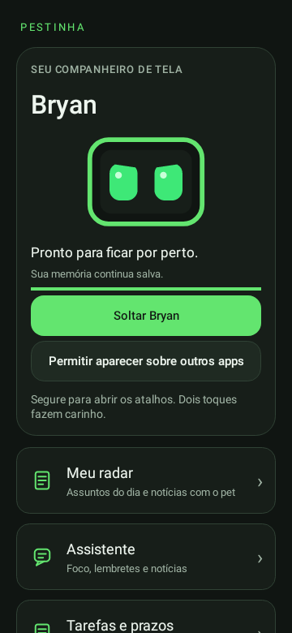
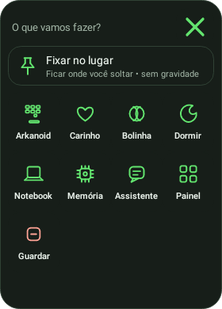
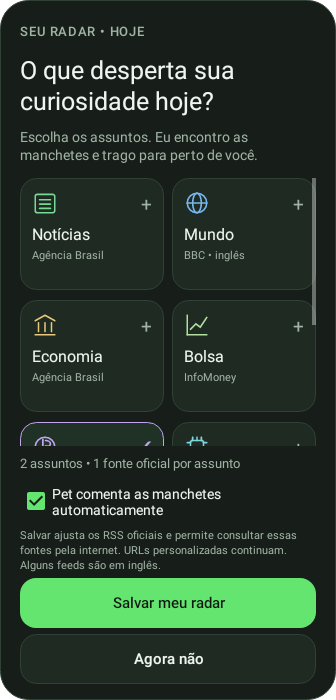
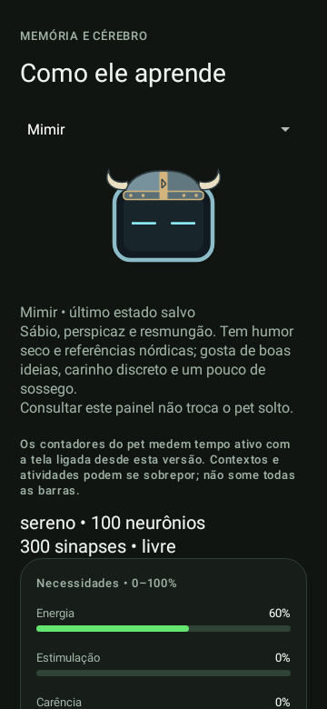
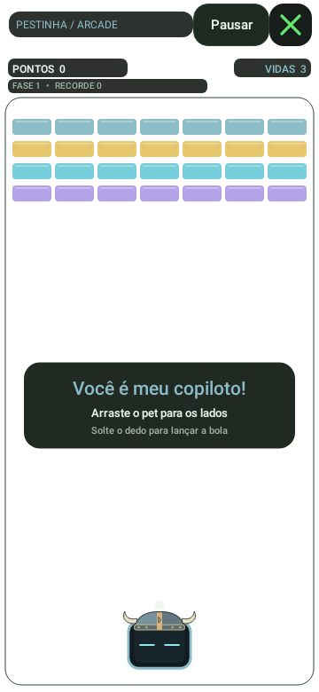

# Pestinha Android — guias e funções

**Versão atual: 0.13 experimental.** Pet flutuante nativo, três personagens,
memória, utilidades e Arkanoid com fundo transparente.

**[Baixar APK direto](https://github.com/duOCELOT/pestinha-duOCELOT/releases/latest/download/Pestinha-Android.apk)** ·
[Release e novidades](https://github.com/duOCELOT/pestinha-duOCELOT/releases/latest) ·
[Apresentação do projeto](../../README.md)

O arquivo da Release já é `.apk`: não requer GitHub Actions, login ou extração de ZIP.
Android 8.0+, ARM64 ou x86_64. Sem Termux, Ubuntu ou VNC.

## Encontre o que procura

| Você quer… | Guia |
| --- | --- |
| Instalar, atualizar, entender gestos/telas, permissões e backup | [Guia das telas e uso](GUIA-DO-APK.md) |
| Jogar com o pet como plataforma, sobre os apps | [Arkanoid](ARKANOID.md) |
| Cadastrar tarefas e acompanhar entregas | [Tarefas e prazos](TAREFAS.md) |
| Escolher interesses do dia e receber manchetes | [Meu radar](MEU-RADAR.md) |
| Consultar a lista de fontes de notícias, bolsa e cripto | [14 RSS oficiais](FONTES-RSS.md) |
| Medir o uso estimado de apps escolhidos | [Pausas conscientes](PAUSAS-CONSCIENTES.md) |
| Entender arquitetura, dados e limites | [Referência técnica](REFERENCIA-TECNICA.md) |
| Compilar, testar ou migrar memória antiga | [README de desenvolvimento](https://github.com/duOCELOT/pestinha-duOCELOT/blob/android/android/README.md) |
| Publicar outra versão em Releases | [Procedimento de publicação](PUBLICAR-RELEASE.md) |
| Ver novidades por versão | [Changelog](../../CHANGELOG.md) |

## Interface

  
  
  

  
  

Prévias de Views reais renderizadas em testes, com dados de exemplo; não capturas de aparelho.
[Origem, transparência e limitações das imagens](images/README.md).

## Funções disponíveis

- Bryan, Jorge e Mimir, com identidades visuais e memórias independentes.
- Arrastar, arremessar, cutucar, carinho, sono, brinquedos, bilhetes, notebook e protestos.
- Menu de segurar, posição fixa, sensores opcionais e ajustes de aparência/movimento.
- Arkanoid com o próprio pet, três vidas, fases, reações e recorde por personagem.
- Tarefas e prazos com estados informados pelo usuário e notificações.
- Água, registro manual de copos, foco, pausas e lembretes locais.
- Radar de interesses, RSS, manchetes em balões e links para os veículos.
- Uso de apps opcional com Acesso ao uso, escolha de apps e recados por sessão/dia.
- Gráficos por personagem e exportação/restauração de memória neural.

## Aprendizado e limites

O cérebro original é uma rede neural pulsada que ajusta associações e registra episódios.
Isso não é um modelo de linguagem: não há conversa livre ou compreensão do conteúdo do celular.
As falas são programadas e as notícias usam texto dos feeds, com fonte. Não há voz, tradução
ou resumo por LLM na versão atual.

Memória, tarefas e registros ficam no aparelho. Notícias precisam de internet e podem atualizar
automaticamente somente quando o usuário habilita o radar e o pet está solto com tela desbloqueada.
O pet/jogo não capturam telas, não leem mensagens e não leem compromissos. Tempo nos apps é
estimado pelo Android, mediante autorização e ativação. Fabricantes podem restringir overlays,
execução em segundo plano e entrega de avisos.

A adaptação é independente de [mille-okws/pestinha](https://github.com/mille-okws/pestinha),
com interface Android Java/Canvas e cérebro original Python via Chaquopy.
[GPL-3.0-or-later](../../LICENSE) · [Documentação original de desktop](../../README-DESKTOP.md).
