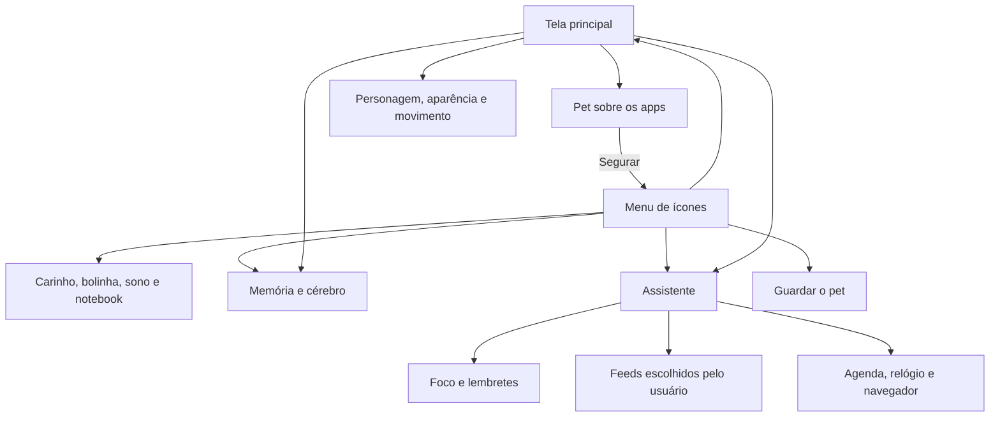

# Pestinha Android — apresentação do projeto

**Material da versão 0.12 experimental.** Este diretório apresenta o APK, suas
interfaces e funções. Foi conferido com o código da branch `android`.

| Para quem | Material |
| --- | --- |
| Quer conhecer o projeto | Esta apresentação |
| Quer instalar, usar e entender cada tela | [Guia do APK e das telas](GUIA-DO-APK.md) |
| Quer escolher fontes de notícias, bolsa e cripto | [Biblioteca de RSS](FONTES-RSS.md) |
| Quer receber recados sobre tempo nos apps | [Pausas conscientes](PAUSAS-CONSCIENTES.md) |
| Quer entender a implementação e os dados | [Referência técnica](REFERENCIA-TECNICA.md) |
| Quer compilar ou migrar uma versão antiga | [README de desenvolvimento Android](https://github.com/duOCELOT/pestinha-duOCELOT/blob/android/android/README.md) |

## O que é

Pestinha Android é um companheiro virtual que aparece sobre os aplicativos do
celular. Você pode arrastar, fazer carinho, brincar com uma bolinha ou deixar o
personagem trabalhar de notebook enquanto usa um timer de foco.

Ele combina duas partes: um pet que reage e aprende associações a partir das
interações, e um painel de utilidades com foco, lembretes e notícias de fontes
escolhidas por você. Sua personalidade aparece nas expressões, no temperamento
e nos bilhetes e cartazes.

É uma adaptação independente do projeto
[mille-okws/pestinha](https://github.com/mille-okws/pestinha). O cérebro original
foi reaproveitado e a interface de desktop foi substituída por uma implementação
nativa para Android. **O APK instalado não precisa de Termux, Ubuntu, Qt ou VNC.**

## Visão da interface

| Tela principal | Menu ao segurar o pet |
| --- | --- |
|  |  |

A versão 0.8 também acrescenta o cartão Pausas conscientes à tela principal.
As imagens são renderizações da interface real em testes Android, não capturas
de um telefone. [Origem e contexto das imagens](images/README.md).

## Personagens

| Personagem | Identidade visual | Temperamento e conteúdo |
| --- | --- | --- |
| **Bryan** | Moldura e olhos verdes, visual original | Curioso e brincalhão; reações do personagem original |
| **Jorge** | Dourado, olhos amarelos e gravata | Sátira de um coach, com frases próprias; personagem fictício |
| **Mimir** | Azul-gelo, olhos claros e elmo viking estilizado | Sábio, resmungão, humor seco e referências nórdicas |

Cada personagem tem rede, aprendizado, necessidades e histórico separados.
Para trocar, guarde o pet, abra **Personagem e aparência**, escolha o nome e
solte novamente. Trocar de personagem não apaga a memória dos demais.

## O que o APK oferece

| Área | Funções implementadas |
| --- | --- |
| Interação | Cutucar, carinho, arrastar, arremessar e abrir atalhos ao segurar |
| Corpo e expressões | Gravidade, quique, animações dos olhos, sono e cores do personagem |
| Brincadeiras | Bolinha, notebook, bilhetes, imagem personalizada para memes e fogos |
| Personalidade | Emoções da rede original, protestos, tristeza e cantinho adaptado |
| Sensores | Movimento por inclinação, calibração e balanço pelo giroscópio disponível |
| Memória | Monitor, associações aprendidas, episódios, consolidação e backup por personagem |
| Produtividade | Foco de 25 minutos, pausa de 5, duração personalizada e lembretes locais |
| Integrações | Solicitar criação de eventos e alarmes nos aplicativos de agenda e relógio |
| Notícias | Biblioteca opcional de 14 feeds dos próprios veículos; seleção diária de temas, leitura manual ou automática opcional com o pet, trechos, fontes, links e cache local |
| Pausas conscientes | Uso estimado dos apps escolhidos, com autorização, limite e recados do personagem |

## Mapa das telas

## O que “aprender” significa aqui

A rede neural pulsada original responde a canais como carinho, cutucada, tédio
e cansaço. O aprendizado ajusta associações entre esses sinais e respostas do
pet. A memória episódica também registra resultados de travessuras e influencia
as próximas escolhas.

Isso **não é um modelo de linguagem**. O APK não oferece conversa livre,
raciocínio geral ou compreensão automática do conteúdo do celular. Os bilhetes
são frases escritas para os personagens, e os trechos de notícias vêm dos feeds.
O termo “sábio” do Mimir descreve o tom do personagem.

## Instalação e estado do projeto

- Android 8 ou mais recente, com suporte a ARM64 ou x86_64.
- O pet precisa de autorização para aparecer sobre outros aplicativos.
- Lembretes dependem de notificações; horários precisos têm autorização opcional.
- Código do app: [branch android](https://github.com/duOCELOT/pestinha-duOCELOT/tree/android).
- APKs: [compilações Android no GitHub Actions](https://github.com/duOCELOT/pestinha-duOCELOT/actions/workflows/android.yml?query=branch%3Aandroid).

Baixe o artefato `pestinha-android-debug` de uma execução concluída com sucesso,
extraia o ZIP e instale o APK. O GitHub pode exigir login e os artefatos podem
expirar; por isso o link acima aponta para as compilações, não para um download
permanente. Os APKs são de desenvolvimento, não uma release da Play Store.

## Limitações e possibilidades futuras

A versão atual não lê telas, mensagens ou compromissos, não observa as janelas
dos outros apps e não usa um LLM. A agenda e o relógio recebem pedidos através
de suas próprias interfaces. Notícias não têm resumo por IA ou busca geral na
internet. A interface Android não reproduz todas as brincadeiras do desktop.

LLM local, diálogo e novas ferramentas podem ser trabalhos futuros; não são
funções disponíveis nesta versão. O Android e cada fabricante também podem
limitar execução em segundo plano, overlays e entrega de notificações.

## Licença

Código sob [GPL-3.0-or-later](../../LICENSE). O fork preserva os créditos do
projeto original. O APK desenha o pet em Canvas e não inclui os memes/imagens da
pasta `assets/` do desktop. O material visual deste guia é gerado pela interface
do próprio projeto.

## Tarefas e prazos (0.9)

O pet pergunta o que você tem para fazer. Toque no convite, escreva a tarefa,
defina a entrega e escolha a frequência de acompanhamento. O painel permite
começar, concluir, adiar o aviso e mudar o prazo. Veja o [guia das tarefas](TAREFAS.md).

## Meu radar (0.10)

Seleção diária de interesses em cartões, RSS configurados por assunto e manchetes
comentadas pelo pet, com fonte e link para a matéria. Veja o [guia do radar](MEU-RADAR.md).

## Arkanoid sobre os apps (0.12)

Segure o pet e escolha **Arkanoid**. O próprio boneco vira a plataforma: arraste
para os lados, quebre os blocos, avance fases e guarde um recorde por personagem.
Pausar/fechar ficam no topo. Veja o [guia do jogo](ARKANOID.md).
