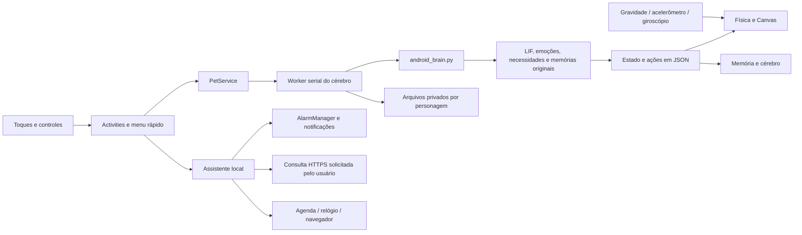

# Referência técnica do APK

**Base: Pestinha Android 0.7 experimental.**
[Apresentação](README.md) · [Guia das telas](GUIA-DO-APK.md)

## 1. Estrutura da aplicação

A interface é nativa, escrita em Java e desenhada com Views/Canvas. O APK
embute Python 3.11 e NumPy pelo Chaquopy para executar os módulos independentes
de Qt do projeto original. Não instala nem inicia um ambiente Linux no telefone.



O serviço do pet trabalha em primeiro plano, com notificação. A simulação é
agendada em um `HandlerThread`, com passo lógico nominal de 0,2 segundo, e o
resultado é enviado à thread da interface. O desenho costuma ser atualizado
em intervalos de cerca de 33 ms, com redução durante sono sem física ativa.
Esses intervalos não são uma garantia de desempenho em todos os aparelhos.

## 2. Telas e componentes

Os links de código abaixo apontam explicitamente para a branch `android`,
inclusive quando este material é lido pela branch `main`.

| Arquivo / componente | Responsabilidade |
| --- | --- |
| [MainActivity](https://github.com/duOCELOT/pestinha-duOCELOT/blob/android/android/app/src/main/java/org/pestinha/android/MainActivity.java) | Tela principal, seções recolhidas, configuração, imagem personalizada e seleção do pet |
| [Design](https://github.com/duOCELOT/pestinha-duOCELOT/blob/android/android/app/src/main/java/org/pestinha/android/Design.java) | Paleta, cartões, botões, estilos e margens das barras do Android |
| [PetService](https://github.com/duOCELOT/pestinha-duOCELOT/blob/android/android/app/src/main/java/org/pestinha/android/PetService.java) | Ciclo de vida do pet, overlay, gestos, worker, atualização de estado e salvamento |
| [PetView](https://github.com/duOCELOT/pestinha-duOCELOT/blob/android/android/app/src/main/java/org/pestinha/android/PetView.java) | Corpo, olhos, brilho, expressões, gravata, elmo e notebook em Canvas |
| [QuickMenu](https://github.com/duOCELOT/pestinha-duOCELOT/blob/android/android/app/src/main/java/org/pestinha/android/QuickMenu.java) | Menu compacto ao segurar; fechamento, posicionamento e encaminhamento das ações |
| [PetWorld](https://github.com/duOCELOT/pestinha-duOCELOT/blob/android/android/app/src/main/java/org/pestinha/android/PetWorld.java) | Bolinha, bilhetes, imagem de meme e fogos em pequenas janelas |
| [Characters](https://github.com/duOCELOT/pestinha-duOCELOT/blob/android/android/app/src/main/java/org/pestinha/android/Characters.java) | Registro dos IDs válidos, nomes e leitura das definições |
| [MemoryActivity](https://github.com/duOCELOT/pestinha-duOCELOT/blob/android/android/app/src/main/java/org/pestinha/android/MemoryActivity.java) | Monitor, exportação, restauração e limpeza dos arquivos de memória |
| [AssistantActivity](https://github.com/duOCELOT/pestinha-duOCELOT/blob/android/android/app/src/main/java/org/pestinha/android/AssistantActivity.java) | Interface de foco, lembretes, notícias e integrações por intents |
| [LocalAssistant](https://github.com/duOCELOT/pestinha-duOCELOT/blob/android/android/app/src/main/java/org/pestinha/android/LocalAssistant.java) | Persistência e agendamento dos avisos locais |
| [AssistantReceiver](https://github.com/duOCELOT/pestinha-duOCELOT/blob/android/android/app/src/main/java/org/pestinha/android/AssistantReceiver.java) | Entrega de avisos e reagendamento nos eventos do sistema |
| [FeedParser](https://github.com/duOCELOT/pestinha-duOCELOT/blob/android/android/app/src/main/java/org/pestinha/android/FeedParser.java) e [FeedClient](https://github.com/duOCELOT/pestinha-duOCELOT/blob/android/android/app/src/main/java/org/pestinha/android/FeedClient.java) | Leitura de RSS/Atom e consultas HTTPS limitadas |
| [MotionSensors](https://github.com/duOCELOT/pestinha-duOCELOT/blob/android/android/app/src/main/java/org/pestinha/android/MotionSensors.java) e [TiltPhysics](https://github.com/duOCELOT/pestinha-duOCELOT/blob/android/android/app/src/main/java/org/pestinha/android/TiltPhysics.java) | Ciclo de vida dos sensores, rotação de eixos, filtragem e integração do movimento |
| [android_brain.py](https://github.com/duOCELOT/pestinha-duOCELOT/blob/android/android/app/src/main/python/android_brain.py) | Ponte dos eventos Android para o núcleo Python e composição do estado exportado à interface |

## 3. Cérebro, comportamento e personalidade

A rede LIF original usa neurônios de integração e disparo com vazamento. Há
canais sensoriais, populações intermediárias e grupos motores. A versão usada
pelo APK tem 470 neurônios; a contagem e o número de sinapses também são exibidos
pelo monitor a partir do objeto real da rede.

| Mecanismo | Papel no APK |
| --- | --- |
| Emoções | Traduzem atividade motora em valência, ativação e expressão |
| Homeostase | Mantém energia, estimulação e necessidade de contato |
| Aprendizado por recompensa | Ajusta associações de contexto em resposta ao carinho e à dispensa |
| Habituação | Reduz sensibilidade a certos estímulos repetidos, com recuperação |
| Condicionamento | Aprende antecipação a pistas como pressionar o pet |
| Memória episódica | Registra contexto, ação e resultado das travessuras |
| Preferências | Ajuda a escolher ações a partir dos resultados anteriores |
| Protesto | Integra insatisfação e estágios de raiva ou tristeza |

As definições dos personagens ficam em
[`pets/`](https://github.com/duOCELOT/pestinha-duOCELOT/tree/android/pets).
Bryan usa semente 7; Jorge, 1729; Mimir, 104729. Temperamento altera ganhos da
rede; aparência define cores e acessórios. Frases particulares e os cartazes
nórdicos de Mimir são configurados pelo adaptador Android.

A interface não entrega ao núcleo o nome do app em primeiro plano, conteúdo
de tela ou teclado global. O contexto é selecionado manualmente. Alguns
comportamentos, como o controle do notebook e o cantinho, são adaptações
explícitas do Android; não são uma portagem completa dos controladores Qt.

## 4. Dados e persistência

### Memória por personagem

Os caminhos são relativos ao diretório privado de arquivos do aplicativo:

```text
files/
└── memory/
    ├── bryan/
    ├── jorge/
    └── mimir/
```

| Arquivo | Conteúdo |
| --- | --- |
| `nervous.json` | Associações plásticas e habituação suportadas pela rede |
| `drives.json` | Energia, estimulação, contato e horário de salvamento |
| `conditioning.json` | Associações antecipadas das pistas |
| `protest.json` | Insatisfação e histórico de protesto |
| `sad_protest.json` | Estado persistente de insatisfação por tristeza |
| `episodes.jsonl` | Episódios resolvidos, um registro JSON por linha |
| `preferences.json` | Preferências e estatísticas por contexto/ação |
| `android.json` | Contadores de interação e saídas do cantinho |
| `snapshot.json` | Último estado reunido para consulta no painel |
| `custom-meme.png` | Imagem escolhida pelo usuário; fora do backup do cérebro |
| `cartazes.txt` | Conteúdo de cartazes gerado para Mimir; não é um aprendizado novo |

O núcleo usa gravação temporária e substituição para seus JSONs. O serviço
tenta salvar periodicamente, ao apagar a tela e ao encerrar o pet. A memória
episódica é aparada durante o salvamento/consolidação, mantendo os 500 episódios
mais recentes suportados pelo núcleo original.

A persistência não é uma imagem binária completa do processo. Variáveis
transitórias, como a posição interna de cada neurônio, objetos abertos e ações
pendentes, não são uma garantia de retomada do mesmo frame após encerrar o app.

### Preferências gerais e Assistente

As preferências `usage` guardam opções, seleção, a última medição dos apps
escolhidos e até 40 recados, sem histórico bruto de eventos. Não entram no
backup do cérebro e não são enviadas aos feeds.

As preferências `pet` guardam seleção, posição e opções de interface. As
preferências `assistant` guardam avisos, feeds e cache. São dados privados do
app, separados da memória neural. Atualizar um APK com a mesma assinatura
normalmente conserva ambos; limpar dados ou desinstalar remove essa área.

O backup JSON de memória tem `format: "pestinha-android"`, versão 1, ID do pet
e um mapa dos arquivos permitidos. Na restauração, o app verifica formato,
personagem, nomes de arquivos, JSONs e semente da definição selecionada. Prepara
uma pasta de restauração antes da troca e tenta reverter se a troca final falhar.

**O backup não inclui configurações gerais, utilidades, feeds ou imagens.** A
exportação com o pet ativo entra na fila do worker e solicita um salvamento
antes de ler os arquivos. A restauração exige o pet guardado.

## 5. Física e sensores

A gravidade projetada no plano da tela determina a aceleração. O código usa
`TYPE_GRAVITY`, ou acelerômetro filtrado quando necessário. O giroscópio é
opcional e acrescenta rotação visual, sem integrar deslocamento por longos
períodos. Rotação da tela, zona morta, amortecimento e limite de velocidade
tratam ruído, orientação e movimentos excessivos.

Listeners usam `SENSOR_DELAY_GAME`, só com o modo habilitado e tela ligada.
São removidos ao desligar o modo, apagar a tela ou encerrar o serviço. Amostras
brutas não são persistidas. Movimentos bruscos podem gerar um estímulo MOTION
para o cérebro, com intervalo mínimo entre eventos.

## 6. Avisos e integrações do sistema

Os avisos locais são registros persistidos e agendados com `AlarmManager`.
O timer de foco/pausa usa um registro de ID 1 e pode substituir o timer anterior;
lembretes recebem IDs próprios. A criação de novos lembretes é bloqueada quando
já há 30 registros pendentes. Cada agendamento possui um token para descartar
callbacks antigos após uma substituição.

Quando há autorização, usa agendamento exato; caso contrário, permite o
agendamento aproximado em repouso. O receiver confere o registro antes de
entregar, remove o aviso entregue para evitar repetição e publica a notificação.
Boot, mudanças de horário e abertura do Assistente podem reagendar os pendentes.
Esses mecanismos não eliminam as restrições do fabricante, de bateria ou uma
parada forçada do aplicativo.

O calendário usa `ACTION_INSERT`, com título, início e fim. O relógio recebe
`ACTION_SET_ALARM` ou `ACTION_SET_TIMER`, sem solicitar que a interface seja
pulada. O app de destino define a experiência final. Não há importação de
compromissos, listagem de alarmes nem edição/exclusão automática desses dados.

## 7. Rede e feeds

A consulta é feita apenas por solicitação no Assistente, em executor separado
da interface. Não existe polling automático de notícias.

| Limite / regra | Implementação |
| --- | --- |
| Fontes | Até dez URLs de feeds escolhidas pelo usuário |
| Transporte | HTTPS, sem usuário/senha na URL e sem fallback para HTTP |
| Redirecionamentos | Laço limitado a cinco tentativas, com validação de HTTPS |
| Tamanho | Corpo da resposta limitado a 1.500.000 bytes |
| Tempo | Timeouts de conexão e leitura de 10 segundos cada; não um prazo total da atualização |
| Itens | Até 30 itens por resposta |
| Texto | Acúmulo limitado por campo; trecho exibido com até 700 caracteres |
| XML | DTDs rejeitados; RSS e Atom tratados como dados |
| Links | Validados para HTTPS; esquemas de execução não viram comandos do app |
| Cache | Última consulta guardada nas preferências do Assistente |

O servidor do feed recebe a conexão normal, incluindo IP e cabeçalhos HTTP.
O cliente não envia memória neural, imagem personalizada, agenda ou lembretes.
Os trechos são do conteúdo publicado pelo feed, não de um modelo de linguagem.

## 7.1. Biblioteca e acompanhamento opcional de apps

`feed-catalog.json` reúne 14 feeds verificados dos próprios editores; não faz
assinaturas nem consultas automaticamente. [Lista e referências](FONTES-RSS.md).

O acompanhamento usa `UsageStatsManager.queryEvents`, com autorização de Acesso
ao uso e ativação explícita. `UsageLedger` acumula períodos de primeiro plano,
encerra sessões em trocas de app/bloqueio e limita totais ao dia local.
`UsageRepository` filtra o que persiste aos pacotes escolhidos, compõe recados,
limita o histórico e aplica intervalo/silêncio. `UsageMonitor` acompanha o ciclo
de vida do serviço e da tela, consultando aproximadamente a cada 30 segundos.

A enumeração do seletor usa apenas apps com atividade de launcher neste perfil,
com uma declaração de `queries` por intent; não pede `QUERY_ALL_PACKAGES`.
Os eventos podem incluir transições de apps não selecionados para encerrar uma
sessão corretamente, mas a sequência bruta não é persistida. Não há leitura de
conteúdo, acessibilidade nem envio dessas medições à rede. A função não oferece
precisão garantida em tela dividida, PiP ou históricos incompletos do fabricante.
[Guia de consentimento, dados e limites](PAUSAS-CONSCIENTES.md).

## 8. Permissões declaradas

| Permissão | Uso |
| --- | --- |
| `SYSTEM_ALERT_WINDOW` | Pequenas janelas do pet, objetos e menu |
| `FOREGROUND_SERVICE` / `FOREGROUND_SERVICE_SPECIAL_USE` | Serviço interativo do pet com notificação |
| `POST_NOTIFICATIONS` | Avisos e notificações no Android que exige autorização |
| `PACKAGE_USAGE_STATS` | Acesso especial opcional ao histórico de uso; depende de autorização do usuário e ativação no app |
| `INTERNET` | Consultas manuais aos feeds configurados |
| `RECEIVE_BOOT_COMPLETED` | Reagendar avisos; não soltar o pet automaticamente |
| `SCHEDULE_EXACT_ALARM` | Precisão opcional, sujeita à autorização do sistema |
| `com.android.alarm.permission.SET_ALARM` | Encaminhar pedidos ao relógio |

Acelerômetro e giroscópio são recursos opcionais. O manifesto não solicita
acessibilidade, leitura de calendário, câmera, microfone ou acesso geral às
imagens. O seletor de documentos concede acesso ao arquivo escolhido.

## 9. Compilação, assinatura e verificações

Requisitos: Java 17+, Gradle 8.13, SDK Android 35, Build Tools 35.0.0 e Python
3.11 no computador de compilação. O APK inclui ARM64 e x86_64, com Android 8+
como mínimo. As versões exatas do plugin e do runtime estão nos arquivos Gradle.

Na pasta `android/`:

```sh
gradle assembleDebug lintDebug verifyDebugPayload testDebugUnitTest
PYTHONPATH=..:app/src/main/python python -m unittest discover -s tests -v
```

O workflow também executa o teste independente da matemática de inclinação.
`syncBrain` copia os módulos originais necessários, e `syncPetAssets` copia as
definições e a licença. `verifyDebugPayload` abre o APK e confere os três pets,
sementes distintas, definição do elmo, licença e aplicação Python.

Os testes também cobrem sessões/totais diários, bloqueio, consentimento, silêncio, intervalo entre recados e catálogo de feeds.
Os testes cobrem o adaptador, aprendizado/restauração, isolamento por personagem,
feeds e URLs, avisos duplicados/obsoletos, cancelamento, física, cores, desenho
do elmo e encaminhamento das ações do menu. As [imagens do guia](images/README.md)
são geradas por Views reais em testes com gráficos nativos.

Testes simulados e compilação não substituem testar toques, permissões, sensores,
consumo e comportamento de segundo plano em aparelhos reais. O projeto é
experimental; não há garantia de funcionamento uniforme em todo fabricante.

Desde a 0.2, os APKs debug usam uma chave fixa de desenvolvimento, pública no
repositório, para conservar a assinatura entre builds. Ela **não é uma chave de
produção**. Uma distribuição de produção exige seu próprio processo de
assinatura. Builds 0.1 usavam outra estratégia; a migração está no README Android.

## 10. Evoluir o projeto

Para adicionar um personagem, crie sua definição em `pets/`, registre o ID em
`Characters`, implemente o conteúdo/acessórios necessários e atualize as
verificações de pacote e testes. Não basta mudar a cor para obter novas
capacidades cognitivas: temperamento, conteúdo e ferramentas são partes distintas.

Para adicionar ferramentas ou um LLM, preserve a separação entre apresentação,
interpretação e execução de ações. A versão 0.8 não implementa esse modelo ou
acesso geral ao celular; essa expansão precisa de um trabalho próprio.


## Painéis e lembretes da versão 0.8

`Hydration` mantém uma única tarefa recorrente (ID reservado 2) no agendador local.
A janela diária usa o fuso local, é restrita ao mesmo dia e o próximo aviso é
calculado a partir da entrega. A repetição troca o token, rejeitando broadcasts antigos.
Preferências `hydration`: ativação, início, fim, intervalo e registro manual diário de copos.
Não estão no backup do cérebro. Alarmes exatos continuam opcionais.

`MetricChart` desenha barras nativas com descrição de acessibilidade, rótulo e valor.
`MemoryActivity` usa um personagem consultado independente do personagem solto;
apenas o personagem ativo recebe o snapshot ao vivo. Os demais leem seus arquivos.
A descrição e os multiplicadores de temperamento são configuração de origem;
necessidades, motores, habituação e contadores vêm do snapshot real.
`android.json` e `snapshot.json` agora preservam `durations` por personagem,
com segundos acumulados apenas nos ticks ativos. Contextos e atividades se sobrepõem.
Não há extrapolação retroativa de contadores nem raster neural simulado.

Testes adicionais: janela de hidratação, repetição e tokens, isolamento do timer de foco,
contagem manual diária, persistência dos tempos e isolamento do painel de Mimir
quando Bryan está ativo. O teste visual emite uma prévia do monitor renderizado.


## Tarefas e prazos (0.9)

O pet pergunta o que você tem para fazer. Toque no convite, escreva a tarefa,
defina a entrega e escolha a frequência de acompanhamento. O painel permite
começar, concluir, adiar o aviso e mudar o prazo. Veja o [guia das tarefas](TAREFAS.md).
