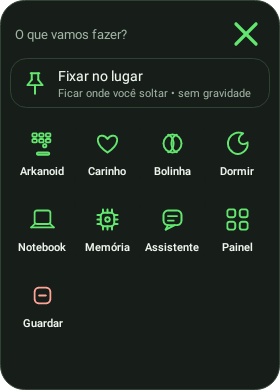
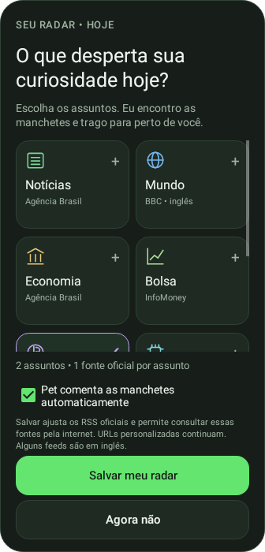
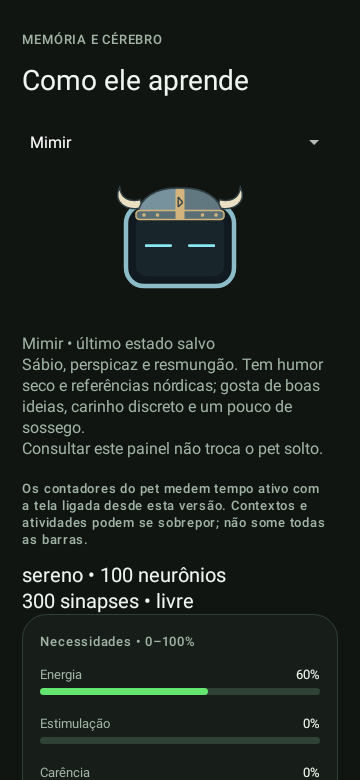
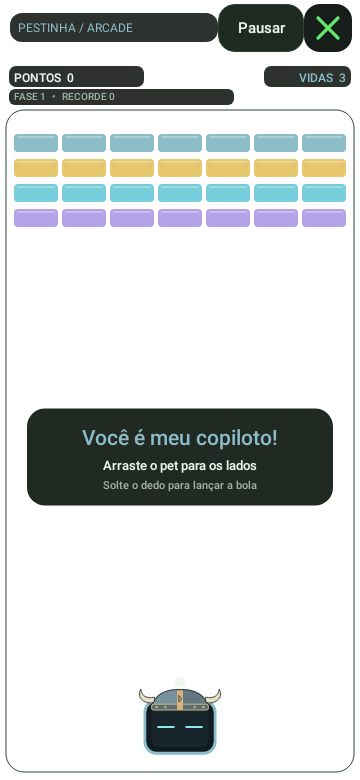

# Android 0.13 — Arkanoid transparente

**Versão arquivada · experimental** · Publicada em 2026-11-02 (UTC)

[Catálogo de versões](../README.md) · [Guia atual](../../GUIA-DO-APK.md) · [Projeto](../../../../README.md)

## Arquivos desta versão

| Arquivo | Acesso |
| --- | --- |
| APK 0.13.0-alpha | [Baixar Pestinha-Android.apk](https://github.com/duOCELOT/pestinha-duOCELOT/releases/download/android-v0.13.0/Pestinha-Android.apk) |
| Hash do APK | [SHA256SUMS.txt](https://github.com/duOCELOT/pestinha-duOCELOT/releases/download/android-v0.13.0/SHA256SUMS.txt) |
| Release e notas publicadas | [Abrir Release 0.13](https://github.com/duOCELOT/pestinha-duOCELOT/releases/tag/android-v0.13.0) |
| Código correspondente | [Tag android-v0.13.0](https://github.com/duOCELOT/pestinha-duOCELOT/tree/android-v0.13.0) |
| Código em ZIP | [Baixar fonte](https://github.com/duOCELOT/pestinha-duOCELOT/archive/refs/tags/android-v0.13.0.zip) |
| Metadados de integridade | [release.json](release.json) |

Android 8.0+, ARM64 ou x86_64. `versionCode 14`. APK experimental de desenvolvimento; 56.8 MB (decimal). O ZIP acima contém **código-fonte**, não o instalador.

## O que mudou

- As áreas vazias do jogo deixam o app aberto visível, sem cobrir a tela com um fundo escuro.
- Blocos, bola, pet e controles continuam visíveis, com fundos locais para textos/placar.
- Mantém a física, as fases e os recordes da 0.12.
- APK interno `0.13.0-alpha`, versionCode 14. [Release específica](https://github.com/duOCELOT/pestinha-duOCELOT/releases/tag/android-v0.13.0), com APK e SHA-256.

## Integridade e atualização

SHA-256 do APK:

```text
e39356425d1f6fc8439397044395f9357c977f1a41c8af94abad41f6b1cb85ba
```

Commit do código: [`9a9d79a63946`](https://github.com/duOCELOT/pestinha-duOCELOT/commit/9a9d79a63946d7030bb7e4f2248e2b93084b3ff3).

Instale uma atualização sobre a versão existente para preservar os dados. Desinstalar ou limpar dados apaga registros locais. O backup neural não inclui todas as configurações do app; consulte o guia antes de remover a instalação. Voltar para uma versão antiga não é uma migração de dados garantida e pode ser bloqueado pelo Android.

Os binários são hospedados apenas na Release correspondente. Esta pasta registra a versão; os guias fora dela descrevem o aplicativo atual.

## Prévias desta versão






Renderizações de testes Android com dados de exemplo, não capturas de aparelho. [Origem das imagens](../../images/README.md).
