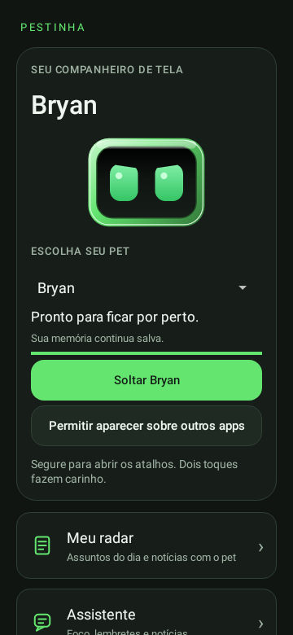
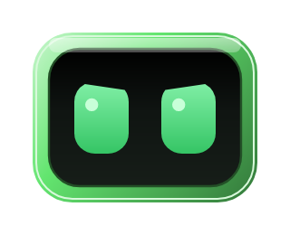

# Android 0.16 — Presidente e seletor no topo

**Versão arquivada · experimental** · Publicada em 2026-11-03 (UTC)

[Catálogo de versões](../README.md) · [Guia atual](../../GUIA-DO-APK.md) · [Projeto](../../../../README.md)

## Arquivos desta versão

| Arquivo | Acesso |
| --- | --- |
| APK 0.16.0-alpha | [Baixar Pestinha-Android.apk](https://github.com/duOCELOT/pestinha-duOCELOT/releases/download/android-v0.16.0/Pestinha-Android.apk) |
| Hash do APK | [SHA256SUMS.txt](https://github.com/duOCELOT/pestinha-duOCELOT/releases/download/android-v0.16.0/SHA256SUMS.txt) |
| Release e notas publicadas | [Abrir Release 0.16](https://github.com/duOCELOT/pestinha-duOCELOT/releases/tag/android-v0.16.0) |
| Código correspondente | [Tag android-v0.16.0](https://github.com/duOCELOT/pestinha-duOCELOT/tree/android-v0.16.0) |
| Código em ZIP | [Baixar fonte](https://github.com/duOCELOT/pestinha-duOCELOT/archive/refs/tags/android-v0.16.0.zip) |
| Metadados de integridade | [release.json](release.json) |

Android 8.0+, ARM64 ou x86_64. `versionCode 17`. APK experimental de desenvolvimento; 56.8 MB (decimal). O ZIP acima contém **código-fonte**, não o instalador.

## O que mudou

- Nome **Presidente**, com descrição curta sem nomes de pessoas ou partidos.
- Textos autorais com bordões populares nas interações, cuidados, tarefas e avisos. Sem voz ou modelo de IA.
- Moldura vermelha forte, orelhas assimétricas, cabelo e barba brancos e faixa decorativa.
- Gradientes de brilho, tela escura e acessórios em camadas nos pets; borda e olhos continuam personalizáveis por personagem.
- Escolha de personagem no cartão superior, junto da prévia. Guarde o pet antes de trocar.
- IDs, memórias, backups e preferências de cores existentes preservados.

## Integridade e atualização

SHA-256 do APK:

```text
29b3ee65edf8d5b03e04bba613de6232e9454c23ba3a54af2e916fb30ebd0a21
```

Commit do código: [`fb1021c3d332`](https://github.com/duOCELOT/pestinha-duOCELOT/commit/fb1021c3d332adf826d4472bf1d128b687a3cd0c).

Instale uma atualização sobre a versão existente para preservar os dados. Desinstalar ou limpar dados apaga registros locais. O backup neural não inclui todas as configurações do app; consulte o guia antes de remover a instalação. Voltar para uma versão antiga não é uma migração de dados garantida e pode ser bloqueado pelo Android.

Os binários são hospedados apenas na Release correspondente. Esta pasta registra a versão; os guias fora dela descrevem o aplicativo atual.

## Prévias desta versão






Renderizações de testes Android com dados de exemplo, não capturas de aparelho. [Origem das imagens](../../images/README.md).
