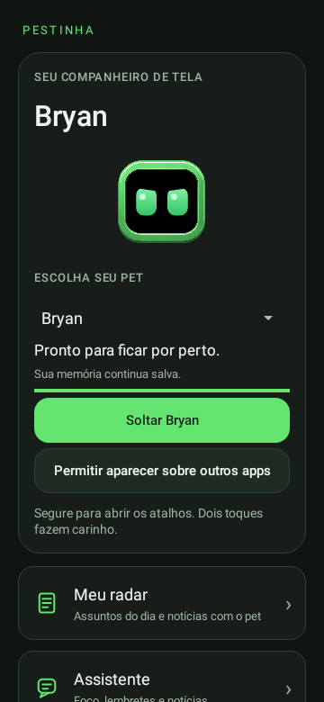

# Android 0.17 — Arte detalhada e personalização

**Versão atual · experimental** · Publicada em 2026-11-03 (UTC)

[Catálogo de versões](../README.md) · [Guia atual](../../GUIA-DO-APK.md) · [Projeto](../../../../README.md)

## Arquivos desta versão

| Arquivo | Acesso |
| --- | --- |
| APK 0.17.0-alpha | [Baixar Pestinha-Android.apk](https://github.com/duOCELOT/pestinha-duOCELOT/releases/download/android-v0.17.0/Pestinha-Android.apk) |
| Hash do APK | [SHA256SUMS.txt](https://github.com/duOCELOT/pestinha-duOCELOT/releases/download/android-v0.17.0/SHA256SUMS.txt) |
| Release e notas publicadas | [Abrir Release 0.17](https://github.com/duOCELOT/pestinha-duOCELOT/releases/tag/android-v0.17.0) |
| Código correspondente | [Tag android-v0.17.0](https://github.com/duOCELOT/pestinha-duOCELOT/tree/android-v0.17.0) |
| Código em ZIP | [Baixar fonte](https://github.com/duOCELOT/pestinha-duOCELOT/archive/refs/tags/android-v0.17.0.zip) |
| Metadados de integridade | [release.json](release.json) |

Android 8.0+, ARM64 ou x86_64. `versionCode 18`. APK experimental de desenvolvimento; 58.6 MB (decimal). O ZIP acima contém **código-fonte**, não o instalador.

## O que mudou

- Arte com brilho, cabelo, roupas e acessórios adaptada das referências fornecidas.
- Transparência, limpeza de pixels isolados e margem para inclinação.
- Olhos animados e cores independentes da moldura/olhos.
- Troca de acessório usa a base detalhada com item desenhado pelo app; camadas detalhadas intercambiáveis ainda no roadmap.
- Lista de próximos passos no README, incluindo avaliar 32 bits. APK continua ARM64/x86_64.
- [Arquitetura e limites da arte](../../ARTE-HD.md).

## Integridade e atualização

SHA-256 do APK:

```text
3e5578cdaae5b8fa61a8d10e65ed7f5182419d702785ab92f9beb9061f5666b5
```

Commit do código: [`360ff5873a46`](https://github.com/duOCELOT/pestinha-duOCELOT/commit/360ff5873a466024b1a2187c2f6c4a766e093463).

Instale uma atualização sobre a versão existente para preservar os dados. Desinstalar ou limpar dados apaga registros locais. O backup neural não inclui todas as configurações do app; consulte o guia antes de remover a instalação. Voltar para uma versão antiga não é uma migração de dados garantida e pode ser bloqueado pelo Android.

Os binários são hospedados apenas na Release correspondente. Esta pasta registra a versão; os guias fora dela descrevem o aplicativo atual.

## Prévias desta versão




Renderizações de testes Android com dados de exemplo, não capturas de aparelho. [Origem das imagens](../../images/README.md).
