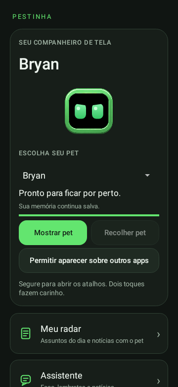

# Android 0.18 — Controles do pet no topo

**Versão arquivada · experimental** · Android 8.0+, ARM64/x86_64 · versionCode 19.

[Catálogo](../README.md) · [Guia](../../GUIA-DO-APK.md) · [Projeto](../../../../README.md)

## O que mudou

- Mostrar pet e Recolher pet lado a lado no cartão superior.
- Botões habilitados conforme o estado do pet, com espera durante preparação e salvamento.
- Comando de recolher removido do final da tela; nomes atualizados no menu e na notificação.

## Arquivos

- [Baixar APK 0.18](https://github.com/duOCELOT/pestinha-duOCELOT/releases/download/android-v0.18.0/Pestinha-Android.apk)
- [SHA256SUMS.txt](https://github.com/duOCELOT/pestinha-duOCELOT/releases/download/android-v0.18.0/SHA256SUMS.txt)
- [Release](https://github.com/duOCELOT/pestinha-duOCELOT/releases/tag/android-v0.18.0)
- [Código correspondente](https://github.com/duOCELOT/pestinha-duOCELOT/tree/android-v0.18.0)
- [Metadados, commit e hashes](release.json)

Instale sobre a versão atual para manter os dados. APK experimental de desenvolvimento, com assinatura fixa. Desinstalar ou limpar dados apaga registros locais.

## Prévia da tela

View Android renderizada em teste, não captura de telefone. [Compilação validada](https://github.com/duOCELOT/pestinha-duOCELOT/actions/runs/41651551275).
