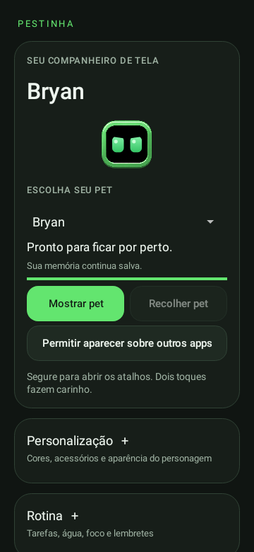
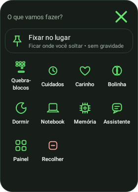
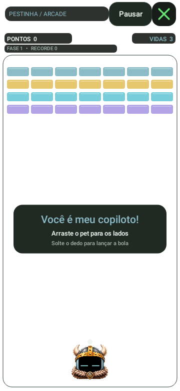

# Android 0.19 — Categorias e Quebra-blocos

**Versão atual · experimental** · Android 8.0+, ARM64/x86_64 · versionCode 20.

[Catálogo](../README.md) · [Guia atual](../../GUIA-DO-APK.md) · [Projeto](../../../../README.md)

## Novidades

- Jogo renomeado para **Quebra-blocos** no painel, menu e acessibilidade. Recordes e memórias mantidos.
- Categorias verticais: Personalização, Rotina, Notícias, Memória, Jogos e interações e Configurações.
- Cabeçalhos **+ / −** com estado salvo e descrição de aberto/recolhido para leitores de tela.
- Cuidados, Assistente e Radar organizados em seções recolhíveis.
- Atalhos de personalização e fontes RSS abrem a seção correspondente diretamente.
- Mostrar pet e Recolher pet continuam juntos no topo. O jogo de estilingue está apenas no roadmap.

## Arquivos

- [Baixar APK 0.19](https://github.com/duOCELOT/pestinha-duOCELOT/releases/download/android-v0.19.0/Pestinha-Android.apk)
- [SHA256SUMS.txt](https://github.com/duOCELOT/pestinha-duOCELOT/releases/download/android-v0.19.0/SHA256SUMS.txt)
- [Release](https://github.com/duOCELOT/pestinha-duOCELOT/releases/tag/android-v0.19.0)
- [Código correspondente](https://github.com/duOCELOT/pestinha-duOCELOT/tree/android-v0.19.0)
- [Metadados, commit e hashes](release.json)

Instale sobre a versão atual para preservar os dados. APK experimental de desenvolvimento, com assinatura fixa. Desinstalar ou limpar dados apaga registros locais.

## Prévias

Views Android renderizadas em teste, não capturas de telefone. [Compilação validada](https://github.com/duOCELOT/pestinha-duOCELOT/actions/runs/41654350495). Históricos de versões anteriores mantêm os nomes e imagens usados na época.
