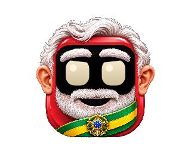

# Android 0.20 — Presidente refinado

**Versão arquivada · experimental** · Android 8.0+, ARM64/x86_64 · versionCode 21.

[Catálogo](../README.md) · [Guia atual](../../GUIA-DO-APK.md) · [Projeto](../../../../README.md)

## Novidades

- Barba branca mais curta e arredondada, com fios menores e bigode natural.
- Orelhas com contornos, dobras e proporções refinados, preservando a assimetria.
- Arte própria para o Presidente e olhos animados ajustados ao rosto.
- Cores, nome, ID, memórias, recordes e demais personagens preservados.

O novo desenho corresponde ao acessório Original. Itens e cores já escolhidos continuam salvos. Trocar de item segue usando a base detalhada com o acessório escolhido.

## Arquivos

- [Baixar APK 0.20](https://github.com/duOCELOT/pestinha-duOCELOT/releases/download/android-v0.20.0/Pestinha-Android.apk)
- [SHA256SUMS.txt](https://github.com/duOCELOT/pestinha-duOCELOT/releases/download/android-v0.20.0/SHA256SUMS.txt)
- [Release](https://github.com/duOCELOT/pestinha-duOCELOT/releases/tag/android-v0.20.0)
- [Código correspondente](https://github.com/duOCELOT/pestinha-duOCELOT/tree/android-v0.20.0)
- [Metadados, commit e hashes](release.json)

Instale sobre a versão atual para manter os dados. APK experimental de desenvolvimento, com assinatura fixa. Desinstalar ou limpar dados apaga os registros locais.

## Prévia do app

View Android renderizada em teste, não captura de telefone. [Compilação validada](https://github.com/duOCELOT/pestinha-duOCELOT/actions/runs/41655741049).
