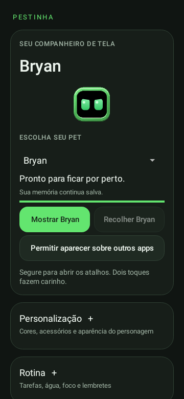

# Android 0.21 — Bryan e controles corrigidos

**Versão atual · experimental** · Android 8.0+, ARM64/x86_64 · versionCode 22.

[Catálogo](../README.md) · [Guia atual](../../GUIA-DO-APK.md) · [Projeto](../../../../README.md)

## Correções

- Definições sem campo de aparência, como a original do Bryan, usam a paleta padrão. Corrige o erro **No value for aparencia** ao iniciar.
- Cores e acessórios escolhidos pelo usuário são aplicados sobre os padrões.
- Nome e descrição são atualizados separadamente da arte; a seleção do Bryan não mantém o nome do personagem anterior.
- Os controles visuais e de acessibilidade identificam o personagem: **Mostrar Bryan / Recolher Bryan**.
- Testes cobrem o Bryan, as personalizações e a troca Presidente → Bryan.

## Arquivos

- [Baixar APK 0.21](https://github.com/duOCELOT/pestinha-duOCELOT/releases/download/android-v0.21.0/Pestinha-Android.apk)
- [SHA256SUMS.txt](https://github.com/duOCELOT/pestinha-duOCELOT/releases/download/android-v0.21.0/SHA256SUMS.txt)
- [Release](https://github.com/duOCELOT/pestinha-duOCELOT/releases/tag/android-v0.21.0)
- [Código correspondente](https://github.com/duOCELOT/pestinha-duOCELOT/tree/android-v0.21.0)
- [Metadados, commit e hashes](release.json)

Instale sobre a versão atual e toque em Mostrar Bryan para iniciar uma nova sessão. Não precisa apagar memória nem restaurar o visual. APK experimental de desenvolvimento, com assinatura fixa. Desinstalar ou limpar dados apaga registros locais.

## Prévia

View Android renderizada em teste, não captura de telefone.
