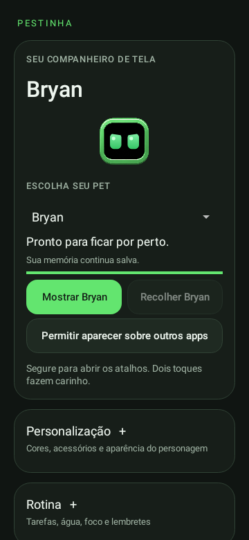
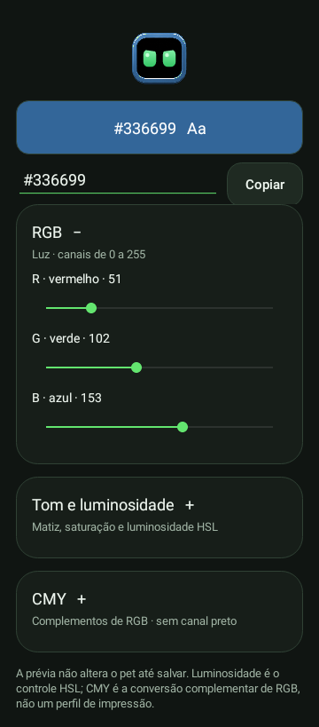
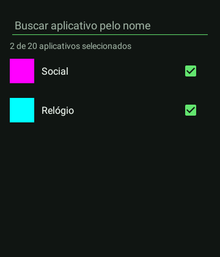
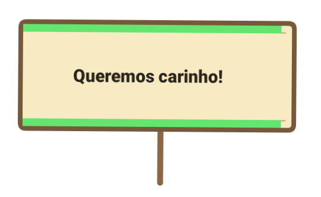
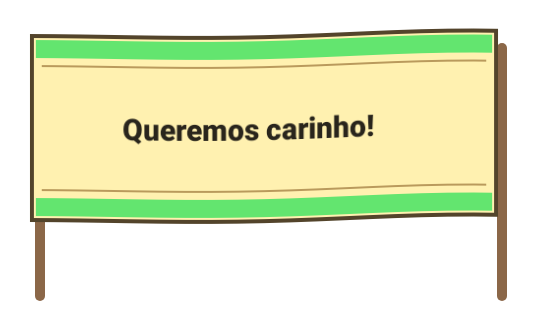
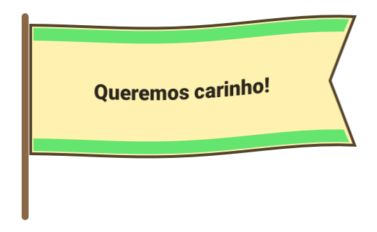
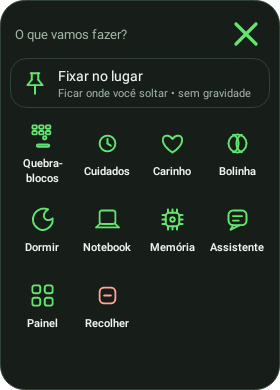

# Android 0.22 — Cores, ícones e protestos

**Versão atual · experimental** · Android 8.0+, ARM64/x86_64 · versionCode 23.

[Catálogo](../README.md) · [Guia das funções](../../CORES-E-PROTESTOS.md) · [Projeto](../../../../README.md)

## Novidades

- Seletor de cor com prévia do pet, HEX, RGB, CMY, matiz, saturação e luminosidade HSL sincronizados.
- RGB aparece primeiro; HEX e Copiar ficam juntos. Salvar aplica e Cancelar preserva o visual.
- Seleção de apps com ícones, nomes, busca e contador de até 20; escolhas fora do filtro continuam marcadas.
- Miniaturas limitadas em tamanho, carregadas em segundo plano. A seleção só é aplicada ao salvar.
- Novo ícone adaptativo e versão monocromática para launchers compatíveis.
- Cartazes, faixas e bandeiras vetoriais, com texto, cor do personagem e animação leve de tecido.
- Prévia em Jogos e interações → Bandeiras e faixas. Protestos espontâneos escolhem a peça conforme sua fase; a animação pausa com a tela apagada e respeita animações desativadas.

Nenhuma permissão é concedida automaticamente e o acompanhamento de apps continua opcional. Cores, memórias e seleções existentes são mantidas. [Como usar e detalhes dos controles](../../CORES-E-PROTESTOS.md).

## Arquivos

- [Baixar APK 0.22](https://github.com/duOCELOT/pestinha-duOCELOT/releases/download/android-v0.22.0/Pestinha-Android.apk)
- [SHA256SUMS.txt](https://github.com/duOCELOT/pestinha-duOCELOT/releases/download/android-v0.22.0/SHA256SUMS.txt)
- [Release](https://github.com/duOCELOT/pestinha-duOCELOT/releases/tag/android-v0.22.0)
- [Código correspondente](https://github.com/duOCELOT/pestinha-duOCELOT/tree/android-v0.22.0)
- [Metadados, commit e hashes](release.json)

Instale sobre a versão atual para manter os dados. APK experimental de desenvolvimento, com assinatura fixa. Desinstalar ou limpar dados apaga registros locais.

## Prévias

Views Android renderizadas em testes, não capturas de telefone. As telas de cores e de apps mostram o conteúdo dos diálogos; os botões de salvar e cancelar ficam na moldura do Android. Os aplicativos e ícones coloridos são dados de exemplo. As peças têm transparência real. A compilação de origem está registrada na seção abaixo.

## Arte do novo ícone

Arte gerada para o primeiro plano do launcher; no aparelho ela é combinada com fundo adaptativo e máscara do launcher. O modo temático usa o desenho vetorial monocromático. [Origem das imagens](../../images/README.md).

## Validação

[Compilação aprovada](https://github.com/duOCELOT/pestinha-duOCELOT/actions/runs/41667351588), com lint, verificação de conteúdo e testes Python/JVM/Robolectric. Os testes verificam conversões de cores, HEX inválido, cancelar sem salvar, seleção de apps fora do filtro e o protocolo de estilos de protesto.
